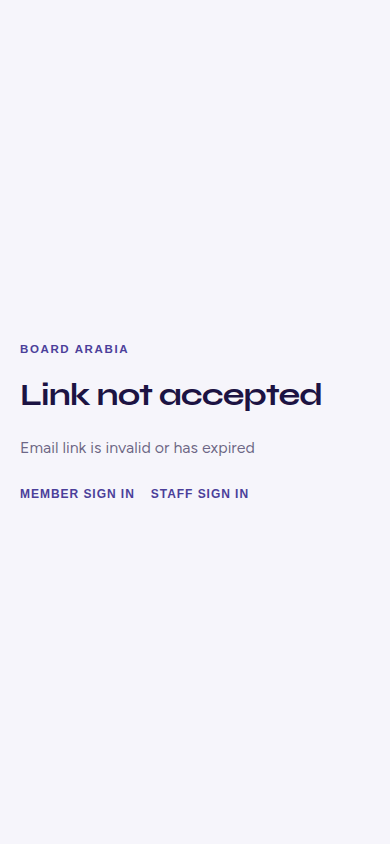
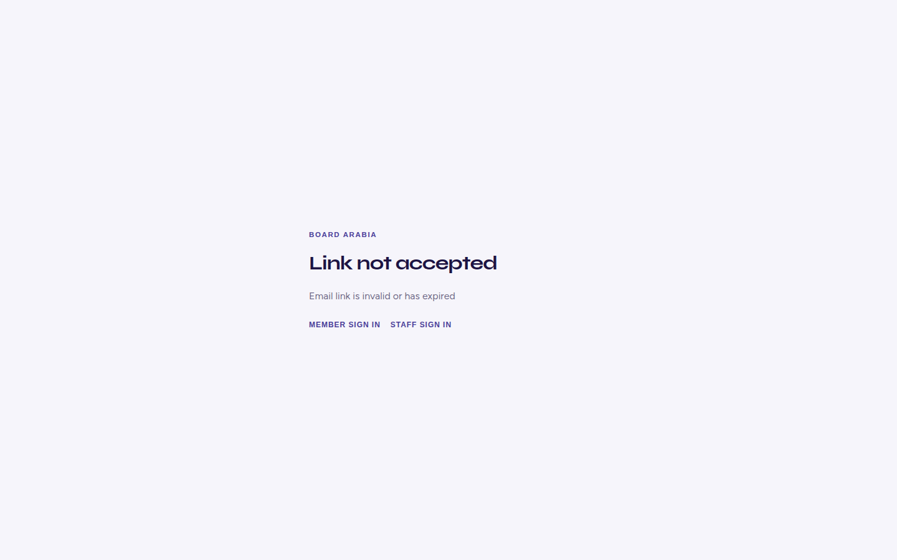
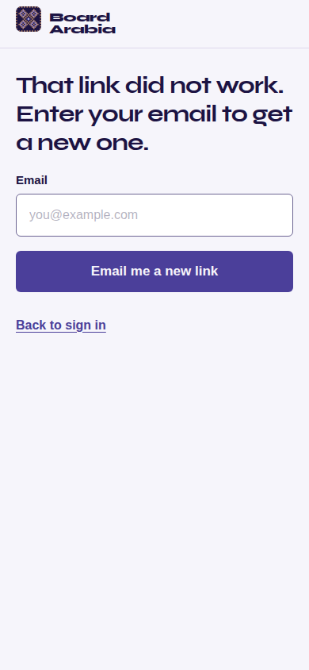
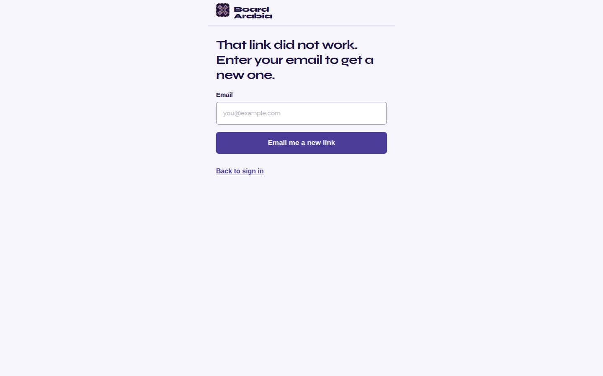
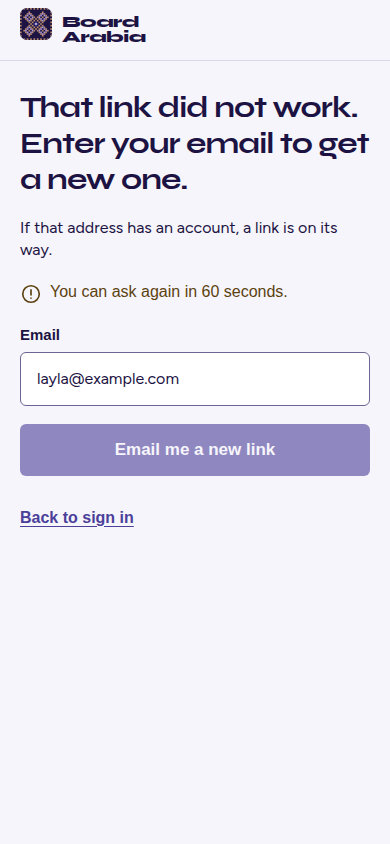
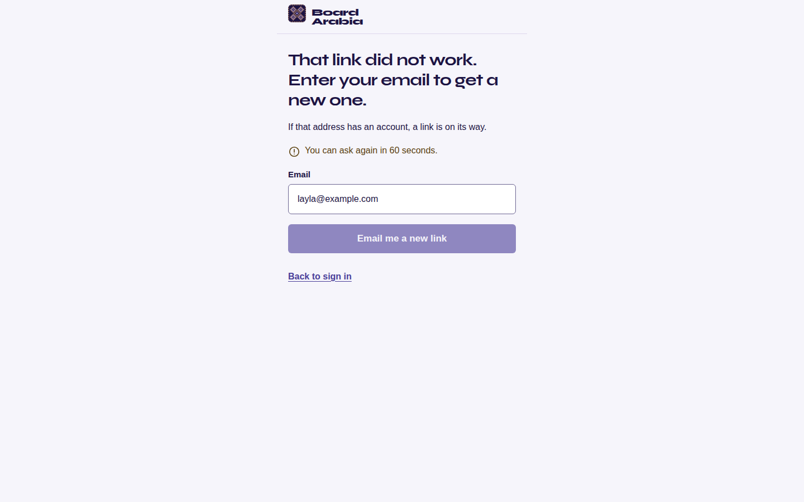
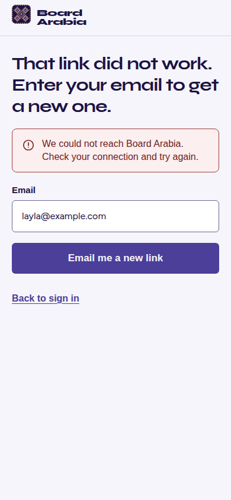
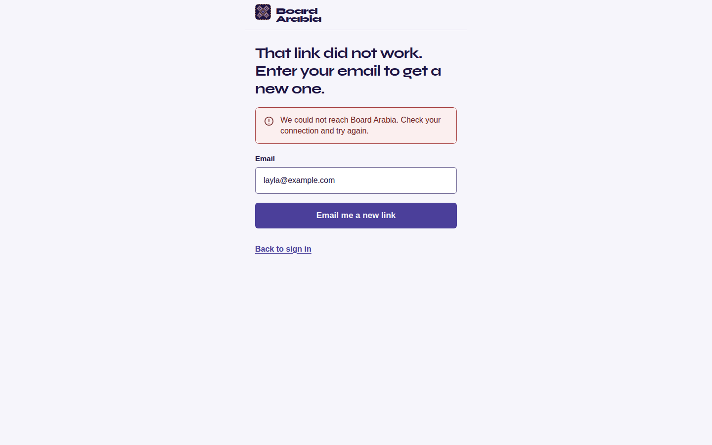

# FD-4 Link problem page

A failed, used, or missing account or reset link on `/auth/confirm` and `/auth/reset` now asks for an email and sends a new link through the existing `request-password-reset` function. No new endpoint. No backend change. No migration. Not merged. Not deployed.

Base at the start of this work: `main` at `4d5914840fa588144e66d101bf04d6bf32d3d7d3`. The branch later merged `main` at `c019412` (Deals tab shortening). VERIFIED. `git rev-list --left-right --count origin/main...HEAD` was `0` behind after that merge.

Cited skills: `board-arabia-ux-ui` and `dashboard-ux-desktop-and-mobile`.

## What changed

The error phase of `src/pages/AuthConfirmPage.tsx` renders `src/pages/LinkProblemScreen.tsx`. The password form on a valid recovery link is unchanged.

- Heading: That link did not work. Enter your email to get a new one. `src/lib/linkProblem.ts` line 3.
- Email field and one primary button, Email me a new link. `src/pages/LinkProblemScreen.tsx` lines 122 and 140.
- The button posts to the existing function. `src/lib/supabase.ts` lines 185 to 187. The reply text is not shown.
- Success, for every address: If that address has an account, a link is on its way. `src/lib/linkProblem.ts` line 4.
- Empty or invalid email: Enter the email address you use for Board Arabia. The sentence is under the field and in the alert above the form.
- Resend cooldown: You can ask again in 60 seconds. The button stays disabled for 60 seconds.
- Network or HTTP 500 and above: We could not reach Board Arabia. Check your connection and try again. The typed email stays.
- Loading: the button reads Sending… and is disabled until the reply arrives.
- Back to sign in goes to `/login`.
- Porcelain page, Night Indigo button, white field, border `#6d6593`. Body text is at least 15px. Controls are at least 44px. The button is 17px and sentence case.

## Shots

Playwright, reduced motion, Vite, fixture host `example.supabase.co`. Before shots are the previous dead end. After shots are the new form. Success and error use `layla@example.com`.

## pr-checks on `7ce9abc`

Cause. VERIFIED. Job https://github.com/Mmm-2023/board-arabia/actions/runs/41119790719/job/124283298474 exited 1. The only failing test was `with the two tier flag off, /apply posts to submit-application` in `scripts/membership-tiers.test.ts` line 300. It expects `lineOf` of `/submit-application` in `src/lib/supabase.ts` to be 162. The run reported 177. `requestPasswordResetLetter` had been inserted above `submitApplication`, which moved that fetch down by 15 lines. The other four checks on that commit were green: crawl, Android debug APK, Android emulator Home, and iOS simulator. VERIFIED from `gh pr checks` on that head.

The log also prints `WebSocket server error: Port 24678 is already in use` many times. INFERRED that those lines are not the failure. The suite still recorded one failure, and that failure is the line pin above.

Fix. VERIFIED. `requestPasswordResetLetter` now follows `submitApplication`. `src/lib/supabase.ts` line 162 is the `/submit-application` fetch again. A local re-run of that same test passed: `node --experimental-strip-types --test --test-name-pattern "with the two tier flag off, /apply posts to submit-application" scripts/membership-tiers.test.ts`. No migration, no Edge edit, and no new address or secret.

Whether the five checks are green on the head that contains this note. UNKNOWN until that run finishes.

## Checks run here

- `scripts/fd4-link-problem.test.ts`: the neutral sentence, validation, cooldown, source locks, and a browser pass at 390 and 1440 (type size, target size, button case, border, overflow, loading, success, network, a second address, a 400 body that is not shown, a 429, a missing link on both routes, and a used invite token).
- `scripts/fd3-signin.test.ts` and `scripts/password-set.test.ts`. `npx tsc -b` and oxlint on the edited files.

## Claims

- The failed link screen has an email field and one primary button that calls `request-password-reset`. VERIFIED. `scripts/fd4-link-problem.test.ts` and `src/lib/supabase.ts` line 187. The Edge function file was not edited.
- The same success sentence is shown for `layla@example.com` and `nobody@example.com`, and the endpoint sentence "If this inbox can sign in, a reset link is on its way." is not shown. VERIFIED. Browser test. `presentLinkProblem` does not take an address. `src/lib/linkProblem.ts` line 24.
- A 400 body that names an account is not shown. The validation sentence is shown instead, and the email stays in the field. VERIFIED. Browser test.
- A network failure keeps the typed email and uses the network sentence. VERIFIED. Browser test and the error shots.
- Empty and invalid emails use "Enter the email address you use for Board Arabia." and do not call the function. VERIFIED. Browser test.
- After a successful ask, the button is disabled and the page says "You can ask again in 60 seconds." VERIFIED. Browser test. The wait is 60 seconds. VERIFIED. `src/lib/linkProblem.ts` line 8 and the unit test.
- Loading, success, and network error are visible. VERIFIED. Browser test and the shots.
- Text is at least 15px, controls are at least 44px, and the primary button is at least 17px and not uppercase. The field border is `#6d6593`. VERIFIED. Browser audit at 390 and 1440.
- `/auth/confirm` and `/auth/reset` with no token, a URL error description, and a failed invite token all show this screen. The raw auth text is not shown. VERIFIED. Browser test.
- Choosing a password on a valid recovery link still calls `updateUser` and `clearPasswordFlag`. VERIFIED. `src/pages/AuthConfirmPage.tsx` lines 176 and 184, and `scripts/password-set.test.ts`.
- Member sign-in still calls `sendPasswordReset` for Forgot your password? and Email me a new link. This page does not. VERIFIED. `scripts/fd3-signin.test.ts` and the source assertion that the link screen does not call `sendPasswordReset`.
- No em dash, no sponsor, no "the desk", no nammco on the new screen. English only. VERIFIED. Source assertion.
- Locked files were not edited: `scripts/prerender.mjs`, `scripts/check-pages-artifact.mjs`, `.github/workflows/pages.yml`, `scripts/public-nammco.mjs`, `src/content/legal/*`, `src/pages/apply/*`, `src/shell/destinations.ts`, `src/components/WhoRunsTheDesk.tsx`. VERIFIED. They are absent from the diff.
- No migration. The newest migration on main at the start was `supabase/migrations/20270113120000_seat_matching.sql`. Nothing was applied and nothing was pushed to the database. VERIFIED.
- Secrets grade: VERIFIED. The diff has no key, token, password, staff mailbox, or staff allowlist. Addresses in the page, the test, and the shots are `you@example.com`, `layla@example.com`, and `nobody@example.com`. The fixture host is `example.supabase.co`.

## Inferences

- Back to sign in is included. INFERRED from the front door brief section 4.5. The binding FD-4 brief requires one primary button and does not remove that link.
- The heading is the error-table sentence, not the longer section 4.5 paragraph about email programs. INFERRED. The FD-4 brief quotes "That link did not work. Enter your email to get a new one." as the heading.
- The success sentence does not mention an accepted application. INFERRED. That re-issue is the later reset-endpoint change. This page only calls the existing function, which already answers every address the same way.
- The 60 second cooldown is enforced on the page. INFERRED. The existing function allows 5 letters an hour and still returns its generic reply when that cap is hit, so it does not produce this sentence. A gateway 429 also shows the sentence.
- The cooldown is one timer for the page. INFERRED. The brief does not say the wait is per address.
- Field errors are repeated above the form. INFERRED from the front door error pattern. The sign-in page already does this.
- Staff sign in is not on this screen. INFERRED. FD-3 put Admin sign in on the sign-in page, and this brief replaces the two tiny links with the email form.
- HTTP 500 and above uses the network sentence. INFERRED. The brief gives one network sentence and no separate server sentence.
- The placeholder `you@example.com` matches the sign-in page. INFERRED.

## Unknown

- Whether a live inbox receives a letter. UNKNOWN. This work does not call the live function and does not send email.
- Whether production is running the function source in this repo, including the 5 letters an hour cap. UNKNOWN.
- Which URL shape a scanner-consumed link uses in production, `error_description` or a used `token_hash`. UNKNOWN. Both shapes show this screen in the mocked browser test.
- Whether a later create-account page will link here or will itself be this route. UNKNOWN. This change only replaces the dead end on the existing confirm and reset routes.
